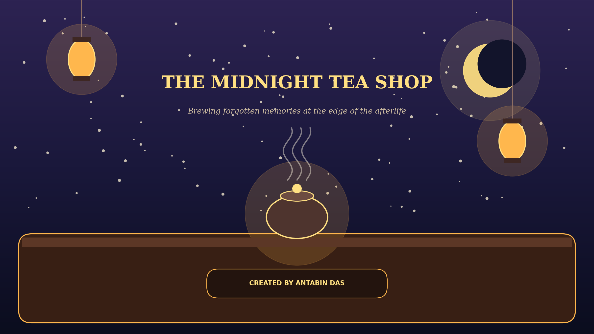

# The Midnight Tea Shop


## Preview Poster
[](assets/poster.png)


## Quick Links
* 🎮 **[Play the Game](https://officialanta-83.github.io/midnight-tea-shop/)**
* 🖼️ **[Open Game Poster](assets/poster.png)**


**Created by Antabin Das**  
🎮 **[Play the Game Live](https://officialanta-83.github.io/midnight-tea-shop/)**

---

## About the Game
**The Midnight Tea Shop** is a cozy narrative puzzle game set in a quiet celestial tea stall between worlds. Lost spirits arrive unable to remember a defining moment from their past. By listening carefully to their stories and steeping the right combination of memory ingredients, you restore their forgotten memories and unlock keepsakes on your shelf.

## How to Play
1. **Listen to the Visitor:** Read the spirit's dialogue clue carefully.
2. **Choose 2 Ingredients:** Select two memory ingredients from your shelf that match the emotions and details in their story.
3. **Steep Tea:** Click **Steep Tea** to brew the blend and restore their lost memory.
4. **Collect Keepsakes:** Unlock all spirit keepsakes and switch between visitors at the stall.

## Project Structure
```text
midnight-tea-shop/
├── assets/
│   └── poster.png    # Game poster artwork
├── index.html        # Complete playable game (HTML, CSS, JS)
├── README.md         # Project documentation
├── LICENSE           # Copyright and attribution notice
└── .gitignore        # System and editor ignore rules

Copyright (c) 2026 Antabin Das. All rights reserved.
